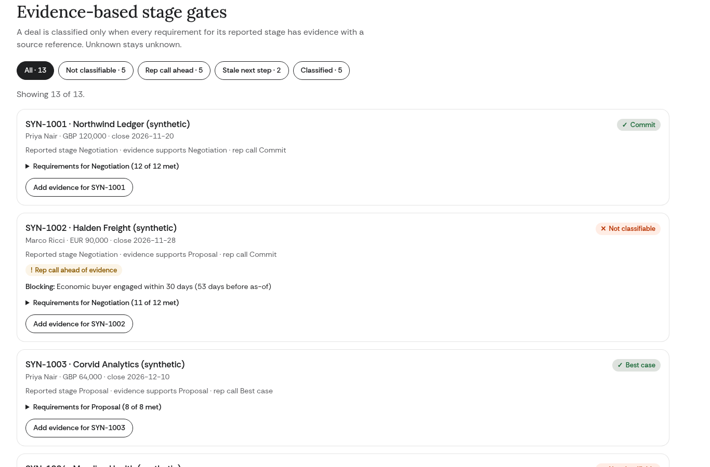

# Forecast Evidence Workbench

**Independent concept by Ayo Ahmed.** Designed around the public [AI & Revenue Operations Lead](https://jobs.ashbyhq.com/light-inc/c8970651-2f80-442d-9c5a-348c845cb116) role at [Light](https://light.inc/). Not an official Light product, and not affiliated with or endorsed by Light. **All data is synthetic.**

A forecast deal is only called confident when the evidence for its stage is recorded with a source reference. Every total states its denominator, and a board narrative goes out of date as soon as the data changes.



## What it does
1. **Import:** one synthetic CSV, previewed row by row with exact source references (`file#row=N`). A file with any rejected row cannot be committed. Commit is atomic and creates one revision.
2. **Stage gates:** MEDDIC fields, economic buyer identified and engaged (dated, sourced, within 30 days at Negotiation), pricing approval (needed above 15% discount), fresh next step. Any missing or unsourced item makes the deal **Not classifiable** and shows what is blocking.
3. **Reconcile:** gross pipeline, weighted forecast on reported vs evidenced stages, closed won for the quarter (only with a sourced contract), category totals that sum to gross, and currencies without an imported rate counted but not converted.
4. **Board narrative:** built from the current revision only, with named next actions per owner. A newer revision supersedes it: struck through, locked from board-ready, and its Markdown export stamped SUPERSEDED.
5. **Evaluation:** 31 expected/actual cases, plus a deliberately broken rule (`eb-named-counts-as-engaged`) that turns the suite red. The adoption hypothesis is stated with an unknown baseline.

Out of scope: ERP accounting, HubSpot or any CRM access, email, model calls, and any time-saved or lift claim.

## Architecture
- `src/engine/`: pure TypeScript rules shared by the Worker, tests and evaluations (CSV parsing, validation, gates, reconciliation with BigInt money, narrative).
- `src/workspace.ts`: SQLite-backed Durable Object, one per visitor cookie. Revisions, previews, narratives, idempotency keys and events, all bounded.
- `src/worker.ts`: routing, security headers, same-origin and JSON checks, visitor cookie.
- `public/`: static UI (no framework, DOM text only, strict CSP).

## Run locally
```bash
npm ci
npm run dev            # http://127.0.0.1:8787
npm run typecheck
npm test               # unit + Worker API tests (starts wrangler dev on :8799)
npm run eval           # expected/actual, exits 0
npm run eval:broken    # deliberately broken rule, exits 1
npm run check:deploy   # Cloudflare Workers Free dry run only
BASE=http://127.0.0.1:8787 CHROME=/path/to/chrome node scripts/ui-check.mjs
```

## Results
72/72 tests, 31/31 evaluation cases, broken rule 28/31 (red as intended), 38/38 browser checks. See [docs/pm/test-results.md](docs/pm/test-results.md) and the raw output in [docs/test-output/](docs/test-output/).

## Documents
- [design.md](design.md) and the [visual guide](docs/visual-guide.html), committed before any app code
- [PM package](docs/pm/README.md)
- [Research and sources](research/)
- [Publication notes and restrictions](PUBLICATION.md)

## Deployment
Configured for Cloudflare Workers Free in `wrangler.jsonc` (SQLite Durable Objects). **Not deployed.** Run only the dry run until the owner approves a destination.

Light's name and logo belong to Light and are used only as context. Code is MIT licensed © 2026 Ayo Ahmed.
